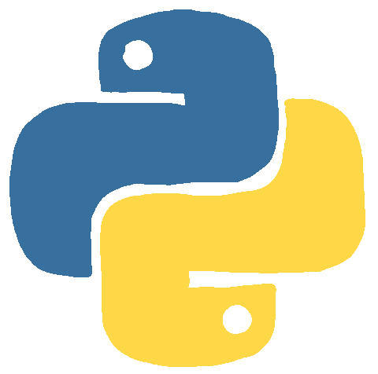
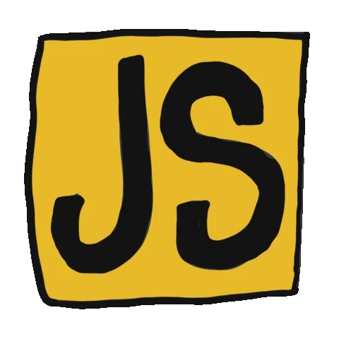
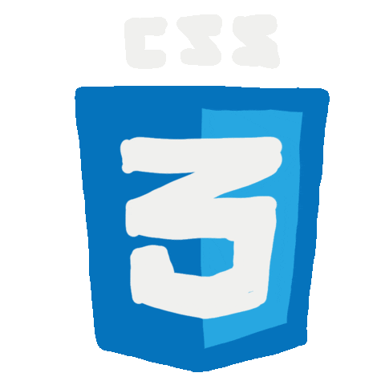
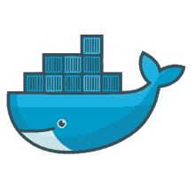

<div align="center">

<h1>
  
  Hi, I'm <b>Devansh</b>
</h1>

<h3><code>Software Engineer</code></h3>


<!-- you can replace font=Fira+Code &color=36BCF7 for new color and font -->

<br/>

<a href="https://github.com/StoicDevansh">
  
</a>
<a href="https://github.com/StoicDevansh?tab=repositories">
  
</a>
<a href="https://github.com/StoicDevansh">
  
</a>

</div>

---


<h3>
  
  About Me
</h3>


```text
🎓 Computer Science and Engineering Student
💻 Software Engineer
🤖 Exploring AI / ML and Agentic AI
🧠 Practicing Data Structures & Algorithms
⚙️ Interested in System Design, Backend & Developer Tools
🚀 Building projects to turn concepts into real-world systems
```

<p>
  
  &nbsp;I enjoy understanding <b>how things work internally</b>, solving problems with <b>clean logic</b>, and continuously improving my <b>engineering fundamentals</b> and <b>problem-solving skills</b>.
</p>


<br>
<h3>🎯 Currently Focused On</h3>

<ul>
  <li>🧠 <b>Data Structures & Algorithms</b></li>
  <li>⚡ <b>C++</b></li>
  <li>💻 <i>Software Engineering fundamentals</i></li>
  <!--
  <li>🐳 <b>Docker & development tooling</b></li>
  <li>🗄️ <b>Databases and backend development</b></li>
  <li>🤖 <b>AI / ML / Agentic AI</b></li>
  <li>🏗️ <b>System Design</b></li>
  <li>🚀 <b>Building and deploying real-world projects</b></li>
  -->
</ul>

<br clear="right"/>

<!-- <div align="center">
  
</div> -->

<!-- SToiccccc -->

<br>
<br>


<div align="center">

<h2>  Technologies & Tools</h2>


<p align="center">
  <a href="https://en.cppreference.com/w/c/language"></a>
  <a href="https://isocpp.org/"></a>
  <!-- <a href="https://isocpp.org/"></a> -->
  </a>
  <!-- <a href="https://www.python.org/"></a> -->
</p>

<p align="center">
  <a href="https://developer.mozilla.org/en-US/docs/Web/JavaScript"></a>
  <!-- <a href="https://developer.mozilla.org/en-US/docs/Web/JavaScript"></a> -->
  <a href="https://www.typescriptlang.org/"></a>
  <a href="https://www.rust-lang.org/"></a>
  <a href="https://www.java.com/"></a>
  <a href="https://www.php.net/"></a>
</p>

<p align="center">
  <a href="https://html.spec.whatwg.org/"></a>
  <!-- <a href="https://html.spec.whatwg.org/"></a> -->
  <a href="https://www.w3.org/Style/CSS/"></a>
  <!-- <a href="https://www.w3.org/Style/CSS/"></a> -->
  <a href="https://www.w3.org/XML/"></a>
  
  
  <!-- <a href="https://www.mysql.com/"></a> --> 
  
  <a href="https://www.postgresql.org/"></a>
  <a href="https://docs.restapi.com/docs/getting-started"></a>
 <!--  <a href="https://www.postgresql.org/"></a> -->
</p>

<p align="center">
  <!-- <a href="https://www.mongodb.com/"></a> -->
 
  <!-- <a href="https://git-scm.com/"></a> -->
  <!-- <a href="https://github.com/"></a> -->
  <a href="https://www.docker.com/"></a>
  <a href="https://www.postman.com/"></a>
  <!-- <a href="https://www.docker.com/"></a> -->
  <a href="https://www.kernel.org/"></a>
  <a href="https://react.dev/learn/"></a>
</p>

<p align="center">
  <!-- <a href="https://www.postman.com/"></a> -->
  <a href="https://github.com/"></a>
  <a href="https://code.visualstudio.com/"></a>
  <!-- <a href="https://code.visualstudio.com/"></a> -->
  <a href="https://n8n.io/"></a>
</p>

<!--  -->

<h3>🧠 Core Skills</h3>

<p align="center">
  <a href="https://isocpp.org/"></a>
  <a href="https://leetcode.com/"></a>
  <a href="https://www.mysql.com/"></a>
</p>

<!--  -->

<h3>🔍 Explored</h3>

<p align="center">
  <a href="https://www.wireshark.org/"></a>
  <a href="https://www.aircrack-ng.org/"></a>
  <a href="https://www.kali.org/"></a>
</p>

<p align="center">
  <a href="https://ubuntu.com/"></a>
  <a href="https://www.debian.org/"></a>
</p>

</div>
</div>
